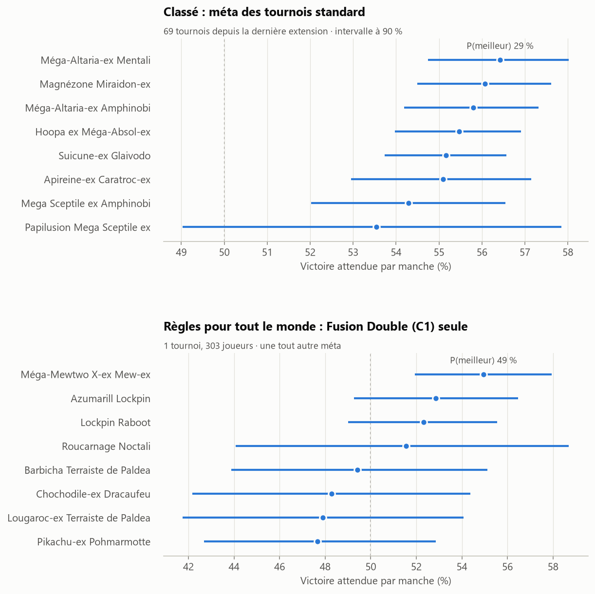

# PTCGP Meta Analyzer

[](https://ptcgp-meta-analyzer.streamlit.app)
[](https://github.com/narusly/ptcgp-meta-analyzer/actions/workflows/tests.yml)
[](https://github.com/narusly/ptcgp-meta-analyzer/actions/workflows/donnees.yml)

Quel deck de Pokémon TCG Pocket a le plus de chances de gagner, contre la méta du moment et avec les
cartes de son choix ? Le projet répond à partir des résultats publics des tournois Limitless : parts de
méta, matchups deck contre deck et taux de victoire attendu de chaque archétype. Il reconnaît aussi les
formats à règles spéciales (« Fusion Double seule », « De A1 à A3b »…) et les analyse à part.

**[Ouvrir l'app](https://ptcgp-meta-analyzer.streamlit.app)** (consultable sur téléphone), mise à jour
automatiquement chaque mardi.



## En bref (méta du 29 octobre au 18 novembre 2026, 69 tournois, 23 338 manches)

| Deck (nom Limitless) | Victoire attendue en classé [IC 90 %] | P(meilleur deck) | Popularité |
|---|---|---|---|
| Méga-Altaria-ex Mentali (Mega Altaria ex Espeon) | 56,4 % [54,7 ; 58,0] | 29 % | 3,4 % |
| Magnézone Miraidon-ex (Magnezone Miraidon ex) | 56,1 % [54,5 ; 57,6] | 18 % | 4,1 % |
| Méga-Altaria-ex Amphinobi (Mega Altaria ex Greninja) | 55,8 % [54,2 ; 57,3] | 11 % | 3,9 % |
| Hoopa ex Méga-Absol-ex (Hoopa ex Mega Absol ex) | 55,5 % [54,0 ; 56,9] | 5 % | 4,7 % |
| Suicune-ex Glaivodo (Suicune ex Baxcalibur) | 55,2 % [53,7 ; 56,6] | 3 % | 5,3 % |

- **Aucun deck ne domine.** Les cinq premiers se tiennent en 1,2 point, et le premier n'a que 29 % de
  chances d'être vraiment le meilleur. Le deck le plus joué (Méga-Dracaufeu Y-ex Entei-ex, 9,6 % des
  joueurs) ne figure pas dans ce haut de tableau.
- **Les matchups comptent au-delà de la force globale.** Sur des tournois que le modèle n'avait pas
  vus, le lissage vers Bradley-Terry prédit mieux que Bradley-Terry seul, que le taux brut et que le
  pile ou face (gains significatifs, voir [Validation](#validation)).
- **Une autre méta quand les règles changent pour tout le monde.** Dans le seul tournoi « Fusion Double
  seule » (PMPT #51, 303 joueurs), le premier est Méga-Mewtwo X-ex Mew-ex : 55,0 % [51,9 ; 57,9], 49 % de
  chances d'être le meilleur. Aucun des cinq decks ci-dessus n'y est jouable.

## Données

| Source | Contenu | Accès |
|---|---|---|
| [Limitless](https://play.limitlesstcg.com) | Tournois Pocket : decklists, archétypes, résultats de chaque match | [API publique](https://docs.limitlesstcg.com/developer), sans clé (50 requêtes / 5 min) |
| [flibustier/pokemon-tcg-pocket-database](https://github.com/flibustier/pokemon-tcg-pocket-database) | Toutes les cartes et extensions | Fichiers JSON, licence MIT |
| [TCGdex](https://tcgdex.dev) | Noms français des cartes (jusqu'à B2a) | API publique, sans clé |

Trois formats Limitless sont téléchargés : le **standard**, **CUSTOM** (règles maison) et **NOEX** (sans
ex), soit 323, 125 et 8 tournois du 23 août au 18 novembre 2026. Un tournoi n'est retenu qu'une fois
terminé (48 h après son début), puis lu depuis le cache local (`data/raw/`, non versionné). Pour les
formats non standard, la fiche `details` est aussi gardée : cartes bannies, tournoi Dual Deck. Les tables
ne gardent que les 120 jours précédant le tournoi le plus récent.

**Mise à jour automatique.** Chaque mardi à 05:17 UTC (les tournois du week-end sont alors terminés
depuis 48 h), une GitHub Action télécharge les nouveaux tournois, reconstruit les tables, vérifie que
l'analyse tourne, puis publie les tables sur la branche [`data`](https://github.com/narusly/ptcgp-meta-analyzer/tree/data),
réécrite en un seul commit : la branche `main` ne contient que le code. L'app en ligne lit ses tables
sur cette branche et les rafraîchit chaque jour. Le cache brut reste dans le cache privé de GitHub
Actions ; une lecture le vendredi l'empêche d'expirer, et s'il expirait quand même, l'Action
retélécharge 90 jours de tournois (environ 2 h) sans rien casser.

**Pseudos des joueurs.** L'analyse n'en a pas besoin : dans les tables, chaque pseudo devient un
identifiant propre au tournoi (`p0001`, `p0002`… dans l'ordre du classement), et les réponses brutes de
l'API ne sont jamais publiées. C'est une pseudonymisation, pas un anonymat (les classements restent
publics sur Limitless), mais les pseudos ne sont pas recopiés en masse et un joueur ne peut pas être
suivi d'un tournoi à l'autre dans nos tables.

### Tables produites (`data/processed/`)

| Fichier | Une ligne par | Colonnes principales |
|---|---|---|
| `sets.csv` | extension | code, nom (en, fr), date de sortie |
| `prints.csv` | impression (extension + numéro) | `card_id`, nom français, rareté, PV, type, faiblesse, retraite |
| `cards.csv` | carte | `card_id`, nom français, extensions où l'obtenir (`sets`), nombre d'impressions |
| `tournaments.csv` | tournoi | date, format Limitless, joueurs, contrôle des bilans, Dual Deck, **format détecté** (`format_id`), réserve déduite |
| `formats.csv` | format à règles spéciales | nom, extensions, sans ex, 1 exemplaire par carte, tournois, joueurs |
| `format_cards.csv` | carte permise en plus dans un format | `format_id`, `card_id`, listes qui la jouent |
| `archetypes.csv` | archétype | identifiant et nom donnés par Limitless |
| `entries.csv.gz` | joueur inscrit | archétype, bilan, classement |
| `deck_cards.csv.gz` | carte d'une decklist | `card_id`, nombre d'exemplaires |
| `matches.csv.gz` | match | joueurs, archétypes, vainqueur, manches gagnées |

## Trois choix qui comptent

**Regrouper les impressions d'une même carte.** Une carte peut exister en plusieurs versions
(illustrations alternatives, rééditions), qui jouent toutes pareil. Le nom du fichier image contient
l'identifiant interne du jeu, commun à toutes ces versions : les 6 impressions de Mega Altaria ex
partagent `PK_011840`. Les statistiques ne suffiraient pas : les Mentali B3a-020 et C1-060 ont les mêmes
PV, type, faiblesse et retraite, mais ce sont deux cartes différentes. Résultat : 4 577 impressions,
2 478 cartes. C'est ce regroupement qui permet de filtrer par extension : une carte reste jouable si au
moins une de ses versions vient d'une extension autorisée.

**Lire correctement les résultats.** L'API code le vainqueur d'un match par le nom du joueur, 0 pour
un nul et -1 pour une double défaite ; une ligne sans adversaire est une exemption. Ce codage a été
vérifié en recalculant le bilan de chaque joueur : il est identique à celui affiché par Limitless pour
99,4 % des joueurs. Ce contrôle est refait à chaque construction (colonne `records_ok`). Seuls les vrais
matchs, gagnés ou nuls, servent aux matchups. Les tournois **Dual Deck** (chaque joueur inscrit deux
decks) sont écartés : un joueur n'y a pas un archétype unique.

**Déduire les règles d'un tournoi de ses decklists.** Limitless ne publie pas la réserve de cartes d'un
tournoi CUSTOM. On la reconstitue, puis on regroupe les tournois qui suivent les mêmes règles (voir
[Formats à règles spéciales](#formats-à-règles-spéciales)).

## Méthode statistique

Deux modes :

- **Classé** : des parties en une manche contre des adversaires au hasard, avec la méta des tournois
  standard. Tes extensions et tes promos ne filtrent que ton deck ; tes adversaires gardent la vraie
  méta.
- **Règles pour tout le monde** : on se place dans un format détecté (Fusion Double seule, De A1 à
  A3b…). Ses tournois donnent la méta, puisque tout le monde y joue avec les mêmes cartes.

Le calcul est le même dans les deux cas :

1. **Période et tournois.** Standard : depuis la sortie de la dernière extension. Format à extensions
   fixes : tout l'historique du format. Format « toutes extensions » (sans ex…) : depuis la dernière
   extension s'il compte au moins 300 joueurs sur cette période, sinon tout l'historique. Les tournois
   dont les bilans recalculés ne collent pas (moins de 95 %) sont écartés : ce sont des tournois par
   équipes que l'API classe en format standard.
2. **Archétypes.** Limitless écrit parfois le même deck dans deux ordres (« Mega Greninja ex Greninja
   ex » et « Greninja ex Mega Greninja ex », aux listes quasi identiques). L'identifiant est découpé en
   Pokémon + version puis trié, ce qui fusionne 112 groupes de doublons. Les decks joués par moins de
   0,5 % des joueurs, ou par moins de 5 joueurs, sont regroupés en « Autres decks ».
3. **Unité d'observation : la manche.** Chaque manche d'un match en deux manches gagnantes compte ; un
   match sans détail des manches vaut une manche (vérifié : ce ne sont pas des forfaits) ; un nul vaut
   une demi-victoire.
4. **Force globale : modèle de Bradley-Terry.** P(A bat B) = πA / (πA + πB), estimé par l'algorithme MM
   de Hunter (2004).
5. **Matchups lissés par Bayes empirique.** Un duel A contre B observé sur peu de manches est tiré vers
   la prédiction de Bradley-Terry p0, avec un poids κ en manches fictives :
   P(A bat B) ~ Bêta(victoires + κ·p0, défaites + κ·(1 − p0)). κ maximise la vraisemblance
   bêta-binomiale de tous les duels observés (κ = 33 sur la période actuelle).
6. **Taux de victoire attendu** : moyenne des matchups pondérée par la popularité des decks adverses
   (miroir à 50 %).
7. **Incertitude** : 4 000 tirages de Monte-Carlo donnent un intervalle à 90 % et la probabilité que
   chaque deck soit le meilleur. Chaque tirage prend d'abord les forces de Bradley-Terry dans leur loi
   normale approchée (écart-type tiré de l'information de Fisher), puis les matchups (lois bêta) et la
   méta (loi de Dirichlet). Sans la première étape, un format où κ est très grand figerait les matchups
   sur une prédiction supposée exacte : sur le format « sans ex », le premier deck (18 listes) avait un
   intervalle de ±0,6 point et 100 % de chances d'être le meilleur, contre [56,2 ; 69,6] et 36 % une
   fois corrigé.

**Réserve de ton deck.** Une liste est jouable si chacune de ses cartes existe dans une extension
cochée. Les 7 dresseurs vendus en boutique (Poké Ball, Recherches Professorales, Potion, Vitesse +,
Scrute Main, Pokédex, Carton Rouge) sont toujours permis. Les **promos d'événement** ne le sont que sur
demande, car beaucoup sont des récompenses d'événements passés. L'effet est faible : sans elles, 7 169
listes standard sur 7 484 restent jouables, et Suicune-ex Glaivodo garde 346 listes sur 393 grâce au
Frigodo de B2a. Pour un deck candidat, seules ses listes jouables comptent, et ses autres listes
servent d'a priori : a = victoires jouables + κ·q, où q vient des autres listes, elle-même lissée vers
Bradley-Terry. Sans filtre, on retrouve exactement le modèle complet (testé). Comme les decks de méta
mélangent beaucoup d'extensions, une **tolérance** accepte les listes auxquelles il manque quelques
exemplaires, en signalant les cartes à trouver ou à remplacer.

**Liste conseillée (les 20 cartes).** Pour chaque deck, l'app conseille la liste exacte qui a le meilleur
taux de victoire estimé, parmi celles jouées à l'identique par au moins 5 joueurs :

1. Pour chaque manche d'un deck contre un adversaire, la probabilité de référence est le matchup du
   deck (moyenne de ses listes jouables).
2. **Effet des cartes**, à adversaire égal : régression logistique avec ce matchup en décalage et, en
   variables, le nombre d'exemplaires de chaque carte variable (centré). A priori β ~ N(0, τ²), avec τ
   choisi par Bayes empirique (vraisemblance marginale de Laplace, tous decks confondus) : τ = 0,045 logit
   par exemplaire, soit au plus un point de victoire environ par carte.
3. **Effet d'une liste** = somme des effets de ses cartes, avec son intervalle (covariance a
   posteriori). Estimer chaque liste séparément ne marche pas : les écarts entre listes entières sont
   exactement ceux du hasard (variance des écarts standardisés 0,97 pour 1 attendu). En mettant en commun
   toutes les listes qui jouent une carte, un léger signal apparaît (10 % des cartes variables au-delà du
   seuil de 5 %, pour 5 % attendus).

La liste la plus jouée reste affichée à côté, avec l'écart entre les deux et les cartes qui changent.

### Validation

Modèles appris sur les tournois du 29 octobre au 10 novembre, testés sur ceux du 11 au 18 novembre
(23 tournois, 6 538 manches ; `python -m ptcgp stats --validate`). Plus bas = meilleur.

| Modèle | Perte logarithmique | Score de Brier |
|---|---|---|
| Pile ou face (50 %) | 0,6931 | 0,2500 |
| Taux brut observé | 0,7054 | 0,2514 |
| Bradley-Terry seul | 0,6918 | 0,2493 |
| **Bradley-Terry + lissage bayésien** | **0,6868** | **0,2469** |

Écart de perte logarithmique par manche du modèle retenu, avec un intervalle de confiance à 95 % par
bootstrap sur les tournois : −0,0063 [−0,0118 ; −0,0014] contre le pile ou face, −0,0185 [−0,0244 ;
−0,0127] contre le taux brut, −0,0050 [−0,0076 ; −0,0019] contre Bradley-Terry seul. Le taux brut fait
pire que le hasard : il colle au bruit des petits échantillons. Les gains restent modestes en valeur
absolue, car une manche de Pocket garde une grosse part de hasard (pioche, pile ou face).

**Effets des cartes, sur les mêmes tournois de test** (10 146 manches vues du côté d'un deck classé) : la
perte logarithmique passe de 0,6857 à 0,6855, soit −0,0002 [−0,0006 ; +0,0002]. Avec une coupure au
7 novembre : 0,0000 [−0,0002 ; +0,0002]. Les cartes n'améliorent donc pas la prédiction de façon mesurable :
**le choix du deck compte, les retouches de liste restent dans le bruit**. La liste conseillée et la plus
jouée se valent à ce que les données permettent de voir ; l'app indique toujours l'écart et son
intervalle (« écart incertain » quand il contient 0).

## Formats à règles spéciales

Le jeu propose parfois des modes où la restriction vaut pour tout le monde (« Extension utilisable :
Fusion Double », avec quelques cartes permises en plus). Des tournois CUSTOM de Limitless reproduisent
ces règles. Pour chaque tournoi CUSTOM ou NOEX d'au moins 8 decklists :

1. **Extensions utilisées.** Couverture gloutonne des cartes jouées : d'abord par les extensions
   normales, puis par les compilations (les Booster de Luxe A4b et B4b ne contiennent que des
   réimpressions et « expliqueraient » sinon à eux seuls dix extensions). Une extension n'est retenue
   que si elle apporte au moins 4 cartes jouées qui n'existent pas aussi en promo. Une extension dont
   toutes les cartes jouées se trouvent déjà ailleurs dans la réserve est retirée. Les cartes restantes
   sont les **cartes permises en plus** (souvent des promos).
2. **Restriction réelle.** Une extension non retenue est **absente** si ses cartes (hors réserve, hors
   ex) sont nettement moins jouées que dans le standard de la même période : test binomial unilatéral,
   p < 10⁻⁶ (environ 2 600 tests), et taux observé inférieur au tiers du taux standard. Les extensions
   d'une même série sont aussi testées ensemble. Une extension sortie depuis moins de 7 jours n'est pas
   testée. Deux règles se lisent aussi dans les listes : **aucun ex** (parmi ceux de la réserve) et
   **un seul exemplaire par carte**.
3. **Garde-fou.** Une vraie restriction par extension laisse, dans chaque série, une suite sans trou
   (A1 à A3b, C1 seule, série B). Un trou trahit une autre règle, sur les Pokémon ou les types :
   « Unova Unleashed » (B2a et B3a absentes entre B1 et B4a) n'est donc pas pris pour un format.
4. **Regroupement.** Un tournoi restreint rejoint le format compatible le plus proche, fondé par un
   tournoi plus grand ; sinon il en fonde un. Les tournois CUSTOM à réserve complète sont écartés : leur
   règle (Dual Deck, mono-type, sans pile ou face…) ne se voit pas dans les decklists.

Sur 133 tournois CUSTOM et NOEX, 25 forment 8 formats, tous conformes au nom de leurs tournois :

| Format détecté | Tournois | Joueurs | Meilleur deck [IC 90 %] | P(meilleur) |
|---|---|---|---|---|
| Toutes les extensions · sans ex | 11 | 646 | Charmillon Papinox (B4) : 63,3 % [56,2 ; 69,6] | 36 % |
| De A1 à A3b (PMPT Throwback A3b, Blast From The Past) | 4 | 353 | Pyroli-ex Phyllali-ex : 56,1 % [51,4 ; 60,9] | 57 % |
| De A1 à A2b (PMPT Throwback A2b & More) | 1 | 321 | Giratina-ex Darkrai-ex : 56,6 % [54,4 ; 58,8] | 71 % |
| Série A, A1 à A4b (PMPT Throwback Finale, Yosh A Series) | 2 | 307 | Tokorico-ex Pikachu-ex : 55,3 % [51,0 ; 59,6] | 52 % |
| De A1 à A1a (PMPT Throwback A1 & A1a) | 1 | 306 | Dracaufeu-ex Sulfura-ex : 55,2 % [48,6 ; 61,9] | 59 % |
| Fusion Double (C1) seule (PMPT #51) | 1 | 303 | Méga-Mewtwo X-ex Mew-ex : 55,0 % [51,9 ; 57,9] | 49 % |
| Sans ex · 1 exemplaire par carte (Gym Leader Challenge) | 4 | 131 | un seul deck à 10 listes ou plus | – |
| Série B, B1 à B4b (Yosh B Series Only) | 1 | 92 | deux decks seulement à 10 listes ou plus | – |

Cas écartés à raison : « 1 Ex Challenge » (peu d'ex, mais aucune extension interdite), « B Block
Mayhem » (22 listes sur 23 jouent des dresseurs de la série A : seule la série des Pokémon est
restreinte), « Tiny Titans » (Pokémon de base à 100 PV maximum).

## Noms français

Les noms viennent de TCGdex (A1 à B2a et Promo-A), puis des traductions de la base de cartes quand elles
sont plausibles : celle-ci contient des erreurs (Mega Sceptile ex traduit « Feunnec ») et des noms
anglais recollés (« GalarianMeowth »), écartés. Une carte prend aussi le nom d'une autre impression ou
d'une autre carte au même nom anglais. À défaut, le nom est reconstruit à partir de l'espèce :
« Mega Greninja ex » donne « Méga-Amphinobi-ex », « Alolan Vulpix » donne « Goupix d'Alola ». Au total,
87 % des cartes ont un nom français ; les autres, surtout des cartes récentes (C1), gardent leur nom
anglais. Les noms reconstruits suivent les conventions de la base (« Méga-Absol-ex ») mais peuvent
différer légèrement de l'écriture officielle, surtout pour les Méga X et Y.

## Interface

[En ligne](https://ptcgp-meta-analyzer.streamlit.app), ou en local avec `python -m ptcgp app`
(http://localhost:8501) :

- **Réglages** (colonne de gauche) : mode, période, extensions de ton deck, promos d'événement (en
  classé), format, extensions et cartes permises (dans un format spécial), tolérance.
- **Ton deck recommandé** (en haut) : le meilleur deck pour ces réglages et sa **liste complète de 20
  cartes**, avec la version de chaque carte à chercher en jeu (« B1-102 », « P-A-005 »), les cartes hors
  de ta réserve, et la liste à copier.
- **Classement** : victoire attendue avec son intervalle à 90 %, P(meilleur), popularité, listes
  jouables, pires matchups, et un graphique des intervalles.
- **Détail d'un deck** : tous ses matchups du pire au meilleur, avec leur intervalle et le nombre de
  manches observées ; onglets « Liste conseillée », « La plus jouée » et « Effet des cartes ».

## Limites

- La méta des tournois sert de substitut à celle du classé, qui n'est pas publique.
- Avec la tolérance, le taux affiché est celui des listes d'origine : remplacer des cartes peut le
  faire baisser.
- Un format spécial repose souvent sur un ou deux tournois : ses intervalles sont larges, et un format
  tout neuf n'a aucune donnée.
- Les règles qui ne portent pas sur les extensions (types, Pokémon seulement, PV) ne sont pas détectées.
- Les tournois Dual Deck sont écartés, alors que leurs appariements disent quel deck a joué chaque manche
  (18 tournois et 2 168 joueurs depuis Dual Fusion) : une piste pour plus tard.
- Les chiffres de ce README datent du 21 novembre 2026 ; l'app, elle, suit la méta chaque semaine.

## Utilisation

```bash
git clone https://github.com/narusly/ptcgp-meta-analyzer && cd ptcgp-meta-analyzer
pip install -e ".[dev]"             # ou ".[app]" pour l'interface seule
python -m ptcgp update              # cartes + tournois des 90 derniers jours + tables et formats
python -m ptcgp build               # reconstruit les tables depuis le cache, sans réseau
python -m ptcgp app                 # interface Streamlit en local
python -m ptcgp stats               # classement pour le classé, et la liste type du premier
python -m ptcgp stats --sets C1,B4b --tolerance 2   # seulement Dual Fusion et le Deluxe Pack
python -m ptcgp stats --event-promos                # avec les promos d'événement
python -m ptcgp formats             # formats à règles spéciales détectés
python -m ptcgp stats --format C1   # classement dans le format « Fusion Double seule »
python -m ptcgp stats --validate    # test sur les tournois les plus récents
python -m ptcgp figures             # figure du README (reports/figures/classement.png)
pytest -q
```

## Crédits

Données de tournois : [Limitless TCG](https://play.limitlesstcg.com). Données de cartes :
[flibustier/pokemon-tcg-pocket-database](https://github.com/flibustier/pokemon-tcg-pocket-database).
Noms français : [TCGdex](https://tcgdex.dev). Projet non officiel, sans lien avec The Pokémon Company,
Creatures, GAME FREAK ou DeNA.
